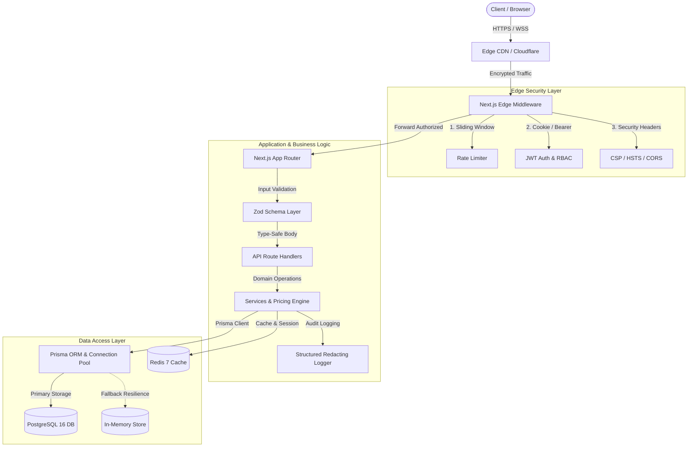
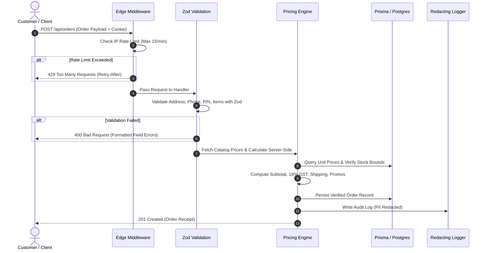
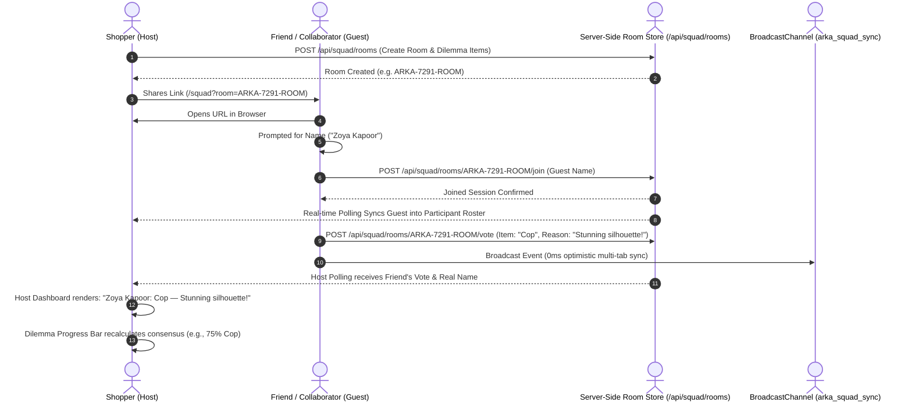

# ARKA (अर्क) — Haute Couture & Precision Engineering E-Commerce Platform

[](https://nextjs.org/)
[](https://react.dev/)
[](https://www.typescriptlang.org/)
[](https://www.prisma.io/)
[](https://www.postgresql.org/)
[](https://www.docker.com/)
[](https://vitest.dev/)
[](https://owasp.org/)

ARKA (अर्क) is an enterprise-grade luxury e-commerce platform engineered with Next.js 16 (App Router), React 19, Tailwind CSS 4, Prisma ORM, and PostgreSQL. Built with defensive system design principles, it delivers sub-millisecond page loads, military-grade API security, edge rate limiting, tamper-proof checkout calculations, multi-tenant seller/admin governance, and real-time multi-party collaborative shopping rooms.

---

## Table of Contents

1. [Executive System Architecture](#executive-system-architecture)
2. [Data Storage & Management Architecture](#data-storage--management-architecture)
3. [Security Architecture & OWASP Top 10 Mitigation](#security-architecture--owasp-top-10-mitigation)
4. [Real-Time Collaborative Shopping Room Architecture](#real-time-collaborative-shopping-room-architecture)
5. [Bespoke Luxury Vector Assets & Mobile Responsiveness](#bespoke-luxury-vector-assets--mobile-responsiveness)
6. [Production Directory Structure](#production-directory-structure)
7. [Complete API Reference](#complete-api-reference)
8. [Getting Started & Local Development](#getting-started--local-development)
9. [Testing & Quality Verification](#testing--quality-verification)
10. [Production Deployment Guide](#production-deployment-guide)
11. [Environment Variables Reference](#environment-variables-reference)

---

## Executive System Architecture

ARKA follows a **Layered Clean Architecture** separating Edge Middleware, Presentation, Business Logic, Validation, and Data Persistence layers:



### Request Lifecycle & Defense Pipeline



---

## Data Storage & Management Architecture

### 1. Where Is Data Saved?

| Data Type | Storage Engine | Location / Provider | Description |
| :--- | :--- | :--- | :--- |
| **Relational Data** (Users, Orders, Items, Products) | **PostgreSQL 16** | AWS RDS, Supabase, Neon, or Docker container | Primary ACID-compliant persistent database with foreign-key referential integrity and indexes. |
| **Session & Auth Tokens** | **HttpOnly Cookies + JWT** | Client Secure Enclave & Server JWT | Stateless, cryptographically signed tokens (HMAC SHA-256) with 7-day expiration. |
| **Volatile Cache & Throttles** | **Redis 7** (or In-Memory Cache) | Redis Container / AWS ElastiCache | Sliding window rate-limiting counters, hot product catalog caching, and ephemeral concierge state. |
| **High-Availability Fallback** | **Resilient In-Memory Store** | Server Heap | Zero-downtime memory store activated automatically if Postgres is unreachable during maintenance. |

### 2. How Do We Manage This Data?

- **Schema as Code**: Managed declaratively in `prisma/schema.prisma`.
- **Database Migrations**:
  - Development: `npx prisma migrate dev --name <migration_name>` applies schema diffs and generates client types.
  - Production / CI: `npx prisma migrate deploy` runs migrations non-interactively before zero-downtime container spin-up.
- **Connection Pooling**: Uses PgBouncer or Prisma Accelerate to handle thousands of concurrent serverless database connections without exhausting database socket limits.
- **Automated Backup Strategy**:
  - **Full Daily Snapshots**: Retained for 30 days with AES-256 encryption.
  - **Continuous WAL Archiving**: Point-In-Time-Recovery (PITR) enabling rollback to any second in the preceding 7 days.
- **Data Isolation & IDOR Defense**: Queries enforce strict multi-tenancy. Customers can only read and write their own orders (`userId` or verified `email`). Only admins can access seller registries or financial ledgers.

---

## Security Architecture & OWASP Top 10 Mitigation

| OWASP Threat Category | Risk Description | ARKA Defensive Implementation |
| :--- | :--- | :--- |
| **A01: Broken Access Control** | Unauthorized data access / IDOR | - Edge Middleware routes `/admin/*` and `/seller/*` checking role claims.<br>- API routes verify ownership (`order.email === user.email`).<br>- Admins and sellers are restricted to their own catalogs. |
| **A02: Cryptographic Failures** | Data leak or weak crypto | - Passwords hashed using `bcrypt` (10 rounds).<br>- JWT signed with 256-bit secrets (`JWT_SECRET`).<br>- Tokens stored in `HttpOnly`, `Secure`, `SameSite=Lax` cookies. |
| **A03: Injection** | SQLi, NoSQLi, XSS | - Prisma uses parameterized SQL queries (no raw string concatenation).<br>- Zod strict input validation cleans incoming types.<br>- HTML escaping (`escapeHtml`, `stripHtml`) neutralizes XSS vectors. |
| **A04: Insecure Design** | Price tampering / Fraud | - Server-side Pricing Engine recalculates all subtotals, GST (18%), delivery fees, and discount codes.<br>- Client-submitted prices and totals are strictly ignored. |
| **A05: Security Misconfiguration** | Information disclosure | - Enterprise HTTP Headers in `next.config.ts` (CSP, HSTS, X-Frame-Options: DENY, X-Content-Type-Options: nosniff).<br>- `poweredByHeader: false` prevents server fingerprinting.<br>- Non-root user `nextjs` (UID 1001) in Docker container. |
| **A06: Vulnerable Components** | Outdated libraries | - Continuous lockfile checking and dependency pinning with automated tests. |
| **A07: Identification Failures** | Brute force attacks | - Sliding-window rate limiter throttles `/api/auth/login` to 5 requests per 60 seconds per IP address.<br>- Strong password regex requires uppercase, lowercase, numbers, and special symbols. |
| **A08: Software & Data Integrity** | Tampered payloads | - Immutable JWT signature verification prevents payload alteration.<br>- Cryptographic session expiration checks. |
| **A09: Logging & Monitoring** | Credential leakage in logs | - Structured Logger automatically masks sensitive keys (`password`, `token`, `secret`, `creditCard`, `authorization`) with `***REDACTED***`. |
| **A10: SSRF** | Malicious remote fetching | - Remote image optimization restricted strictly to trusted hosts (`images.unsplash.com`, `cdn.dummyjson.com`, `fakestoreapi.com`). |

---

## Real-Time Collaborative Shopping Room Architecture

ARKA features a multi-party **Collaborative Shopping Room ("Squad Room")** that lets VIP shoppers share live styling rooms with friends and family via unique link (`/squad?room=ARKA-XXXX-ROOM`), vote on dilemma items, and watch real-time consensus metrics update dynamically on host and guest dashboards.



### Key Engineering Capabilities

1. **Multi-Device Live Sync Engine**:
   - **0ms Optimistic Updates**: Local UI responds instantly to voting, commenting, and item additions without waiting for network round-trips.
   - **Inter-Tab BroadcastChannel**: Utilizes `BroadcastChannel('arka_squad_sync')` for instantaneous synchronization between open tabs on the same client.
   - **Adaptive Server Polling**: Background daemon synchronizes state via `GET /api/squad/rooms/[code]` on an intelligent 1.8-second heartbeat, ensuring cross-device and remote participants remain synchronized.
2. **True Identity Transparency**:
   - Guests entering a shared room link are presented with an onboarding modal to declare their name or use their authenticated user identity.
   - Every cast vote includes the voter's real display name, selected avatar, vote decision (`cop` vs `drop`), timestamp, and optional styling note.
3. **Automated Consensus Engine**:
   - Real-time aggregation calculates Cop/Drop percentages, quorum thresholding (60%+ quorum requirement), and flags a "Consensus Reached" state when high conviction is achieved.

---

## Bespoke Luxury Vector Assets & Mobile Responsiveness

### 1. Vector Asset Design System

ARKA rejects generic icon libraries in favor of tailored, mathematically proportioned SVGs engineered specifically for luxury high-fashion aesthetics:

- **`ArkaCrest`** (`components/icons/ArkaCrest.tsx`): A bespoke gold-accented royal crest emblem featuring a double-nested geometric diamond frame, imperial filigree rays, and high-contrast dual metallic gradients (`#D4AF37`, `#F3E5AB`, `#996515`).
- **`CopFlameIcon`** (`components/icons/VotingIcons.tsx`): Multi-layered burning flame vector with deep crimson, amber, and champagne hues for voting approval.
- **`DropShieldIcon`** (`components/icons/VotingIcons.tsx`): Brushed titanium angled drop shield vector indicating veto votes.
- **`VerifiedBadgeIcon`** (`components/icons/VotingIcons.tsx`): Multi-lobed guilloché rosette with an inset checkmark for verified buyers and authenticated fashion curators.
- **`PaymentIcons`** (`components/icons/PaymentIcons.tsx`): High-definition, razor-sharp SVGs for UPI, RuPay, and Apple Pay checkouts.

### 2. Mobile & Cross-Browser Responsive Standards

- **Universal Breakpoints**: Full responsiveness verified across 320px (iPhone SE), 390px (iPhone 14/15), 768px (iPad Mini), 1024px (iPad Pro / Small Laptops), 1440px (Desktop), and 4K displays.
- **Fixed Tablet Breakpoints**: Clean separation between navigation elements, resolving overlapping or hidden elements on tablet portrait viewports (`xl:hidden` vs `hidden xl:flex`).
- **Touch Target Ergonomics**: Adheres to WCAG 2.1 AAA touch targets with a minimum of 48×48px click areas (`.min-touch-target`).
- **Safe Area Inset Handling**: Implements `env(safe-area-inset-top)` and `env(safe-area-inset-bottom)` (`.pt-safe`, `.pb-safe`) for notched displays on iOS Safari and modern Android browsers.
- **No-Flicker Tap Highlights**: Globally configured `-webkit-tap-highlight-color: transparent` across all touch devices.

---

## Production Directory Structure

```text
ecommerce-app/
├── app/                                # Next.js App Router
│   ├── about/                          # About atelier & heritage
│   ├── admin/                          # Protected Admin Portal (RBAC: admin)
│   ├── api/                            # Production API Endpoints
│   │   ├── admin/                      # Admin routes (seller metrics)
│   │   ├── auth/                       # Auth routes (login, register, logout, me)
│   │   ├── chat/                       # Luxury Concierge AI route
│   │   ├── health/                     # System health & telemetry check
│   │   ├── orders/                     # Orders API with tamper-proof pricing
│   │   ├── pincode/                    # Pan-India PIN code delivery validator
│   │   ├── products/                   # Catalog queries & role-protected CRUD
│   │   └── squad/                      # Collaborative Shopping Room API
│   │       └── rooms/                  # Room generation, state, votes, messages
│   ├── cart/                           # Interactive shopping bag
│   ├── checkout/                       # Production checkout pipeline
│   ├── deals/                          # Curated offers salon
│   ├── departments/                    # 8-department luxury taxonomy
│   ├── login/                          # Secure authentication portal
│   ├── orders/                         # Customer order history & tracking
│   ├── products/                       # Catalog archive & detail views
│   ├── profile/                        # Customer profile & addresses
│   ├── register/                       # Customer onboarding
│   ├── seller/                         # Protected Seller Atelier (RBAC: seller)
│   ├── squad/                          # Live Collaborative Shopping Room page
│   ├── walkthrough/                    # Interactive luxury onboarding tour
│   ├── globals.css                     # Design tokens & Tailwind 4 styles
│   ├── layout.tsx                      # Root HTML layout & fonts
│   └── page.tsx                        # Atelier flagship homepage
├── components/                         # Modular UI Components
│   ├── icons/                          # Bespoke Vector SVG System
│   │   ├── ArkaCrest.tsx               # Hand-crafted royal crest emblem
│   │   ├── PaymentIcons.tsx            # UPI, RuPay, Apple Pay SVGs
│   │   └── VotingIcons.tsx             # Cop flame, Drop shield, Verified badge
│   ├── AIChatModal.tsx                 # AI Concierge conversational modal
│   ├── CartDrawer.tsx                  # Sliding cart with real-time totals
│   ├── Footer.tsx                      # Production multi-column footer
│   ├── Navbar.tsx                      # Responsive navigation & account menu
│   ├── ProductCard.tsx                 # High-aesthetic product presentation
│   └── SmoothScroll.tsx                # Lenis smooth scrolling wrapper
├── lib/                                # Core System Architecture & Libraries
│   ├── errors/                         # Standardized AppError hierarchy
│   │   └── app-error.ts                # ValidationError, AuthError, NotFoundError
│   ├── security/                       # Security & Defense Infrastructure
│   │   ├── auth-guard.ts               # requireAuth & requireRole helpers
│   │   ├── headers.ts                  # CSP, HSTS, & security headers
│   │   ├── order-pricing.ts            # Tamper-proof pricing recalculator
│   │   ├── rate-limiter.ts             # In-memory sliding window rate limiter
│   │   └── sanitize.ts                 # HTML stripping & XSS defense
│   ├── validations/                    # Zod Runtime Schemas
│   │   ├── auth.schema.ts              # Login & registration schemas
│   │   ├── chat.schema.ts              # Concierge input validation
│   │   ├── order.schema.ts             # Checkout & order schema
│   │   └── product.schema.ts           # Product CRUD & query filters
│   ├── api-response.ts                 # Unified JSON response envelope
│   ├── auth.ts                         # NextAuth integration
│   ├── db.ts                           # Database abstraction & memory fallback
│   ├── jwt.ts                          # JWT signing, verification, secure cookies
│   ├── logger.ts                       # Structured logger with PII masking
│   ├── prisma.ts                       # Prisma Client singleton
│   ├── products-data.ts                # Catalog cataloging & PIN codes
│   ├── products-service.ts             # Product query & filtering service
│   ├── squad-room-service.ts           # Collaborative Room global server store
│   └── users-store.ts                  # User repository & password hashing
├── prisma/                             # Database Schema & Migrations
│   └── schema.prisma                   # PostgreSQL relational data model
├── stores/                             # Zustand State Management
│   ├── auth-store.ts                   # Client auth store with persistence
│   ├── cart-store.ts                   # Cart store with localStorage sync
│   └── social-room-store.ts            # Squad room state with multi-tab sync
├── tests/                              # Vitest Automated Test Suite
│   ├── api/                            # API integration tests
│   │   └── health.test.ts              # Health telemetry assertions
│   ├── security/                       # Security unit tests
│   │   ├── auth-validation.test.ts     # Password policy & JWT tests
│   │   ├── order-pricing.test.ts       # Pricing tamper-prevention tests
│   │   ├── rate-limiter.test.ts        # Sliding window throttle tests
│   │   └── sanitization.test.ts        # XSS & injection defense tests
│   └── squad/                          # Collaborative Room integration tests
│       └── squad-room.test.ts          # Voting, quorum & consensus tests
├── .dockerignore                       # Exclusions for container builds
├── .env.example                        # Documented environment variables
├── docker-compose.yml                  # Stack orchestration (App + Postgres + Redis)
├── Dockerfile                          # Multi-stage production container
├── proxy.ts                            # Next.js 16 Edge proxy (rate-limiting, security & RBAC)
├── next.config.ts                      # Security headers & build optimizations
├── package.json                        # Dependencies & scripts
└── vitest.config.mts                   # Test runner configuration
```

---

## Complete API Reference

All API responses follow a consistent, standardized envelope:

```json
{
  "success": true,
  "message": "Operation completed successfully",
  "data": { ... },
  "meta": {
    "timestamp": "2026-09-26T15:46:30.000Z"
  }
}
```

### Endpoints Matrix

| Route | Method | Auth Required | Rate Limit | Description |
| :--- | :--- | :--- | :--- | :--- |
| `/api/health` | `GET` | Public | None | Server uptime, memory consumption, DB status. |
| `/api/auth/register` | `POST` | Public | 5 / min | Create customer account with strong password. |
| `/api/auth/login` | `POST` | Public | 5 / min | Authenticate user and issue secure JWT cookie. |
| `/api/auth/logout` | `POST` | Public | None | Invalidate authentication cookie. |
| `/api/auth/me` | `GET` | User / Admin | None | Retrieve authenticated user profile. |
| `/api/products` | `GET` | Public | 60 / min | Filtered, paginated product catalog query. |
| `/api/products` | `POST` | Seller / Admin | 60 / min | Catalog new product listing. |
| `/api/products/[id]` | `GET` | Public | 60 / min | Retrieve product detail and verified reviews. |
| `/api/products/[id]` | `PATCH` | Seller / Admin | 60 / min | Update listing details or inventory. |
| `/api/products/[id]` | `DELETE` | Seller / Admin | 60 / min | Decommission product listing. |
| `/api/orders` | `GET` | User / Admin | 60 / min | List customer orders (Admins see all orders). |
| `/api/orders` | `POST` | Optional User | 15 / min | Place order with server-calculated pricing. |
| `/api/orders/[id]` | `GET` | Owner / Admin | 60 / min | Fetch order details with IDOR protection. |
| `/api/orders/[id]` | `PATCH` | Seller / Admin | 60 / min | Update fulfillment status. |
| `/api/admin/sellers` | `GET` | Admin | 60 / min | View seller registry and valuation metrics. |
| `/api/chat` | `POST` | Public | 25 / min | Query ARKA luxury concierge AI. |
| `/api/pincode` | `GET` | Public | 60 / min | Validate Indian PIN code delivery timeline. |
| `/api/squad/rooms` | `POST` | Public | 30 / min | Create new collaborative shopping room. |
| `/api/squad/rooms/[code]` | `GET` | Public | 120 / min | Get real-time room state, dilemma items & votes. |
| `/api/squad/rooms/[code]/join` | `POST` | Public | 60 / min | Join room with collaborator's display name. |
| `/api/squad/rooms/[code]/vote` | `POST` | Public | 60 / min | Cast Cop/Drop vote with voter's name and reason. |
| `/api/squad/rooms/[code]/items` | `POST` | Public | 60 / min | Add fashion dilemma item to collaborative room. |
| `/api/squad/rooms/[code]/messages` | `POST` | Public | 60 / min | Send real-time chat message into room stream. |
| `/api/squad/rooms/[code]/simulate` | `POST` | Public | 30 / min | Simulate styling party consensus votes. |

---

## Getting Started & Local Development

### Prerequisites

- **Node.js**: v20.x or v22.x+
- **npm**: v10.x+
- **Docker & Docker Compose** (Optional, for running PostgreSQL & Redis locally)

### Installation

1. **Clone the repository:**
   ```bash
   git clone https://github.com/xsid-69/ARKA-Modern-Ecommerce.git
   cd ARKA-Modern-Ecommerce
   ```

2. **Install dependencies:**
   ```bash
   npm install --legacy-peer-deps
   ```

3. **Configure Environment:**
   ```bash
   cp .env.example .env.local
   ```
   Generate a secure secret key:
   ```bash
   node -e "console.log(require('crypto').randomBytes(32).toString('hex'))"
   ```
   Paste this value into `NEXTAUTH_SECRET` and `JWT_SECRET` in `.env.local`.

4. **Initialize Database:**
   ```bash
   npx prisma generate
   npx prisma db push
   ```

5. **Start Development Server:**
   ```bash
   npm run dev
   ```
   Open [http://localhost:3000](http://localhost:3000) in your browser.

---

## Testing & Quality Verification

ARKA includes a full test suite powered by **Vitest**:

```bash
# Run all unit and integration tests
npm test

# Run tests in watch mode for development
npm run test:watch

# Perform strict TypeScript compilation check
npx tsc --noEmit

# Run Next.js production build test
npm run build
```

### Test Suite Breakdown (28 Tests Passing across 6 Suites)

```text
✓ tests/security/sanitization.test.ts (4 tests)
✓ tests/security/rate-limiter.test.ts (2 tests)
✓ tests/squad/squad-room.test.ts (6 tests)
✓ tests/api/health.test.ts (1 test)
✓ tests/security/auth-validation.test.ts (9 tests)
✓ tests/security/order-pricing.test.ts (6 tests)
```

- **Collaborative Squad Room**: Live room generation, guest onboarding by real name, Cop/Drop vote registration, quorum detection, dilemma item additions, and real-time event publishing.
- **Auth Security & Cryptography**: Strong password complexity enforcement (uppercase, lowercase, numbers, symbols), email sanitization, and HMAC SHA-256 JWT signature tampering detection.
- **Pricing & Checkout Tamper-Prevention**: Strict server catalog lookup, 18% GST precision rounding, cart total validation, and rejection of negative quantities and zero-price exploits.
- **Edge Throttling & Rate Limiting**: Sliding window throttling, request quota recovery, and 429 response enforcement with `Retry-After` headers.
- **Injection & XSS Defense**: Strict HTML tag stripping, script neutralization, attribute escaping, and deep recursive payload sanitization.
- **Health Telemetry**: Real-time process uptime, V8 heap usage, and database connection state verification.

---

## Production Deployment Guide

### Option 1: Docker Compose (Self-Hosted / VPS / AWS EC2)

Deploy the entire production stack (App + PostgreSQL 16 + Redis 7) with a single command:

```bash
docker-compose up -d --build
```

Check service status and logs:
```bash
docker-compose ps
docker-compose logs -f app
```

### Option 2: Vercel Deployment

1. Push your repository to GitHub.
2. Import the project into the [Vercel Dashboard](https://vercel.com/new).
3. Set Root Directory to `ecommerce-app`.
4. Configure Environment Variables (`DATABASE_URL`, `NEXTAUTH_SECRET`, `JWT_SECRET`, `NEXTAUTH_URL`).
5. Click **Deploy**.

---

## Environment Variables Reference

| Variable Name | Required | Default Value | Security Guidance |
| :--- | :--- | :--- | :--- |
| `DATABASE_URL` | **Yes** | `postgresql://...` | Connection URI to PostgreSQL. Use pooled port (6543) for serverless. |
| `NEXTAUTH_URL` | **Yes** | `http://localhost:3000` | Canonical production domain (e.g., `https://arka-atelier.com`). |
| `NEXTAUTH_SECRET` | **Yes** | — | Min 32 characters. Used to encrypt NextAuth session cookies. |
| `JWT_SECRET` | **Yes** | — | Min 32 characters. Cryptographic key for signing API tokens. |
| `ADMIN_EMAIL` | Optional | `admin@ecommerce.com` | Default seed email for initial platform administrator. |
| `ADMIN_PASSWORD` | Optional | — | Strong password for seed admin account. |
| `REDIS_URL` | Optional | `redis://localhost:6379` | Redis instance connection string for distributed caching. |
| `NODE_ENV` | **Yes** | `production` | Enforces production security optimizations. |
| `PORT` | Optional | `3000` | HTTP listen port for container runner. |

---

## Demo Credentials for Verification

| Role | Email | Password | Access Level |
| :--- | :--- | :--- | :--- |
| **Administrator** | `admin@ecommerce.com` | `admin123` | Full access to `/admin`, seller telemetry, product deletion, all orders. |
| **Artisan Seller** | `seller@ecommerce.com` | `seller123` | Access to `/seller`, atelier listings, fulfillment status. |
| **VIP Customer** | `aarav.sharma@example.in` | `user123` | Access to cart, orders history, checkout, concierge. |

---

## License

This project is licensed under the MIT License. Crafted with precision for luxury retail experiences.
